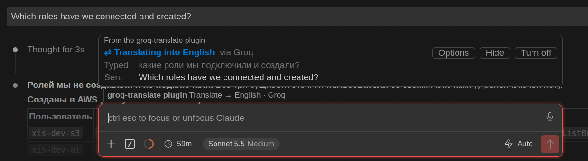

# groq-translate

A Claude Code plugin: type in any language, and Claude receives **only the translation** (English by default). The translation is done by a model on [Groq](https://groq.com) (the free tier is enough). Based on [prompt-translate](https://github.com/BruceXcluding/prompt-translate) (MIT), with only the Groq engine kept.



## What it does

- Translates what you type before it is sent. The chat keeps your original text; Claude reads only the translation.
- Code, paths, `@file` mentions, URLs and identifiers (`parseConfig()`, `snake_case`, `camelCase`) are swapped for `⟦n⟧` placeholders before Groq sees the text and put back afterwards. If a translation loses one, Groq is asked once more; if it loses one again, the original is sent.
- Blocks the host adds (`<system-reminder>`, `<ide_opened_file>`, `<ide_selection>`, …) are never translated.
- English text, slash commands (`/…`), shell lines (`!…`) and code-only prompts go as typed, with no request to Groq.
- If Groq fails or no key is set, the original is sent with a notice. **Claude never translates instead**, so no subscription usage is spent on translation.
- A band above the prompt shows what you typed (`Typed`) beside what was sent (`Sent`), with a model picker and an off switch.

## Install

From GitHub:

```bash
claude plugin install groq-translate --marketplace oleg909902/groq-translate
```

From a local folder:

```bash
git clone https://github.com/oleg909902/groq-translate
claude plugin marketplace add ./groq-translate
claude plugin install groq-translate@groq-translate
```

Then set the key inside a `claude` session in a terminal: `/plugin configure groq-translate@groq-translate` → `groqApiKey`. It is kept in secure storage. Get a free key at [console.groq.com/keys](https://console.groq.com/keys).

## Commands

| Command | What it does |
|---|---|
| `/translate` | Show the status |
| `/translate on` / `off` | Turn translation on / off for the session |
| `/translate <language>` | Change the target language (`en`, `de`, `Russian`, …) |
| `/translate model <id>` | Change the Groq model; `default` goes back to `openai/gpt-oss-120b` |

## Settings

| Key | Default |
|---|---|
| `language` | `English` |
| `enabled` | `true` |
| `groqApiKey` | — |
| `groqModel` | `openai/gpt-oss-120b` (also good: `openai/gpt-oss-20b`, `qwen/qwen3.8-27b`) |

## Tests

```bash
claude plugin validate . && claude plugin test .
```

## Where your data goes

Only the typed words, with code and paths taken out, go to `api.groq.com`, with the key in the `Authorization` header. No other network requests are made and no files are read.

## License

MIT. See [LICENSE](LICENSE).
